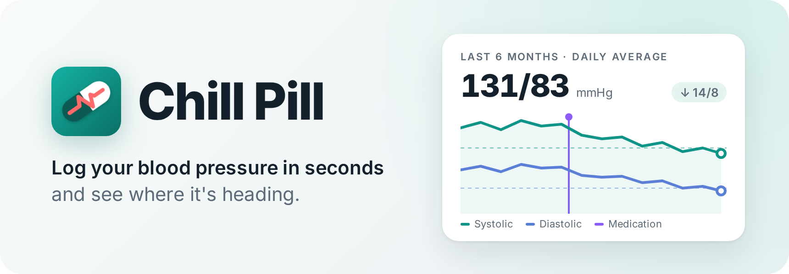

<h1 align="center">
  
</h1>

<p align="center">
  Log your blood pressure in seconds and see where it's heading.
</p>

<p align="center">
  <a href="https://github.com/ackervekenbm/chill-pill/actions/workflows/ci.yml"></a>
  <a href="https://github.com/ackervekenbm/chill-pill/actions/workflows/docker-build.yml"></a>
  <a href="LICENSE"></a>
  <a href="https://github.com/ackervekenbm/chill-pill/pkgs/container/chill-pill"></a>
</p>

You just took your blood pressure, the cuff is still on the table, and the
numbers are on the screen. Chill Pill is the app you open on your phone right
then: type three numbers, tap save, done. Over weeks and months it turns those
readings into daily averages and a clear trend, with your target and your
medication changes on the same chart, so you and your doctor can see what's
working.

It replaces the spreadsheet: no PC needed, no empty rows to fill in, and a
chart that actually follows the calendar. It runs in one small container on a
Raspberry Pi or any other box at home, and your readings never leave it.

*Every screenshot shows made-up demo readings.*

## Highlights

- ⚡ **Quick entry.** The number pad opens on systolic and jumps to the next field as soon as a value is complete. Time is filled in for you; change it to add a reading for an earlier day. Saved by mistake? Undo.
- 📅 **Daily averages.** Readings on the same day become one daily average, however many you take, and every day counts the same in the trend.
- 📈 **A trend that follows the calendar.** Ranges from one month to everything (1M, 3M, 6M, 1Y, All), morning or evening only, dashed target lines, and a summary of your average and the share of days on target.
- 💊 **Medication markers.** Note a medication change and it shows on the chart. Tap it to compare the month before with the month after.
- 🩺 **Doctor report.** A clean, printable page with the summary, chart, medication changes and every reading. Print it or save it as a PDF.
- 🎨 **Three themes:** Clinical calm, Dark dashboard and Warm editorial.
- 📱 **Installable on your iPhone.** Add it to your home screen and it opens full screen, like a native app.
- 📤 **CSV export.** All readings and medication changes in one file that opens in any spreadsheet.
- 🍓 **Runs on a Raspberry Pi.** One small container for `amd64` and `arm64`, nothing to configure.

<table>
  <tr>
    <td align="center"><br><sub>Clinical calm</sub></td>
    <td align="center"><br><sub>Dark dashboard</sub></td>
    <td align="center"><br><sub>Warm editorial</sub></td>
  </tr>
</table>

<p align="center">
  
</p>

<details>
<summary><strong>Run it</strong></summary>

You need **Docker**. Nothing else: no accounts, no keys.

```bash
curl -O https://raw.githubusercontent.com/ackervekenbm/chill-pill/main/docker-compose.yml
docker compose up -d
```

Open <http://localhost:8184> (or `http://<server-ip>:8184` from your phone)
and save your first reading. The image is public and built for `amd64` and
`arm64`, so any 64-bit OS works, a Raspberry Pi included.

Updating is `docker compose pull && docker compose up -d`; your readings stay
in the `chill-pill-data` volume. OpenMediaVault, settings, backups and HTTPS
are in [docs/deploy/](docs/deploy/README.md), with a guide per setup:
prebuilt image, OpenMediaVault, built from a checkout, bare Node.

</details>

<details>
<summary><strong>Install on your iPhone</strong></summary>

1. Open Chill Pill in **Safari** on your iPhone (your phone has to be on the
   same network as the server).
2. Tap **Share**, then **Add to Home Screen**, then **Add**.

It now opens full screen from its own icon, straight into the entry card. The
same works on Android from the browser menu (**Add to Home screen** or
**Install app**).

</details>

<details>
<summary><strong>Import from a spreadsheet</strong></summary>

Already tracking in a spreadsheet? Bring it in once with the importer, run
from a copy of this repository on your computer (Node 22 or newer):

```bash
npm install
npm run import -- path/to/your.xlsx --to http://<server-ip>:8184 --dry-run   # check what it finds
npm run import -- path/to/your.xlsx --to http://<server-ip>:8184
```

It reads the `DATA` tab: a `Date` column and up to three groups of systolic,
diastolic and pulse per row. Empty rows are skipped and incomplete ones are
listed. Imported readings have no time, so they count as morning readings.
Running it twice adds nothing twice. Details:
[docs/deploy/operations.md](docs/deploy/operations.md#importing-a-spreadsheet-one-time).

</details>

<details>
<summary><strong>Develop</strong></summary>

You need Node 22 or newer.

```bash
npm install
npm run dev                 # API on :3094, app on :5184 (open this one)
npm run seed -- --to http://localhost:3094   # fill an empty dev instance (it refuses one that already has readings) with made-up readings
```

```bash
npm run build               # type-check, lint, client build, server build
npm test                    # unit and component tests
npm run icons               # redraw the app icons from scripts/gen-icons.mjs
```

The README banner and screenshots come from `scripts/banner.mjs` and
`scripts/screenshots.mjs` (made-up demo data only; Playwright is installed for
the run, not as a dependency). Architecture and conventions are in
[AGENTS.md](AGENTS.md).

Tech stack: React 19 · TypeScript · Vite · Recharts · Express 5 ·
better-sqlite3 · Vitest + Testing Library.

</details>

<details>
<summary><strong>Data &amp; privacy</strong></summary>

- Everything lives in one SQLite file on your own server
  (`/app/data/chill-pill.db` in the container): readings, notes, medication
  changes and your settings. Back up that folder, or use **Settings → Export
  CSV** for a copy you can open anywhere.
- There is **no login**. Anyone who can reach the app can read and change your
  readings, so keep it on your home network or tailnet and never forward a
  port to it from the internet.
- No accounts, no tracking, no telemetry. The app doesn't call out to anything.
- Chill Pill shows your numbers against the target you choose. It doesn't
  diagnose anything; talk to your doctor about what the numbers mean.

</details>

## Contributing

Issues and pull requests are welcome; `npm run build && npm test` must pass,
and the README and docs change in the same pull request when what they
describe changes (see [AGENTS.md](AGENTS.md)). Security problems: see
[SECURITY.md](SECURITY.md).

## License

Chill Pill is free software under the
[GNU Affero General Public License v3.0 or later](LICENSE).
