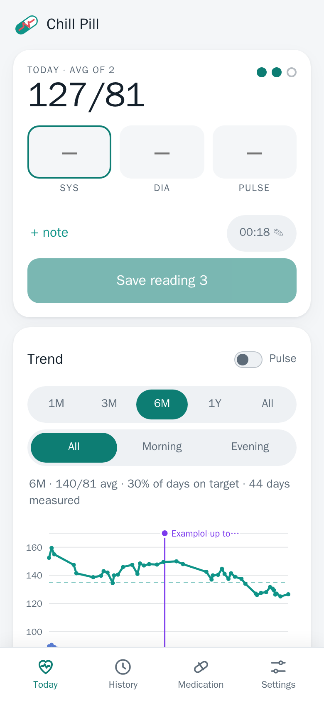
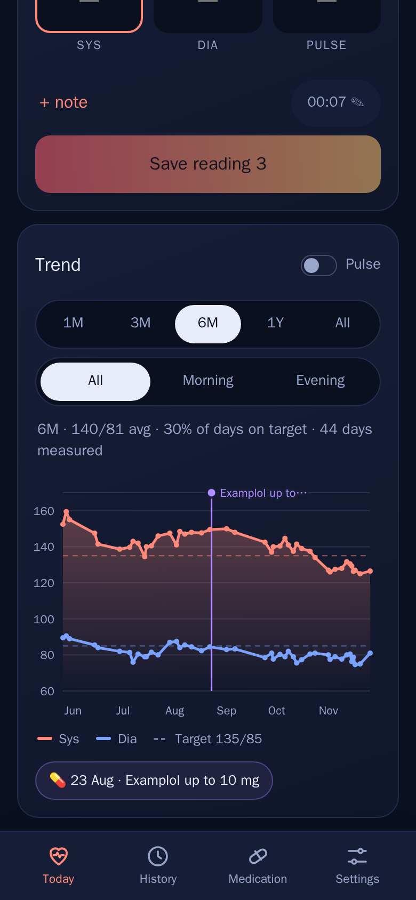
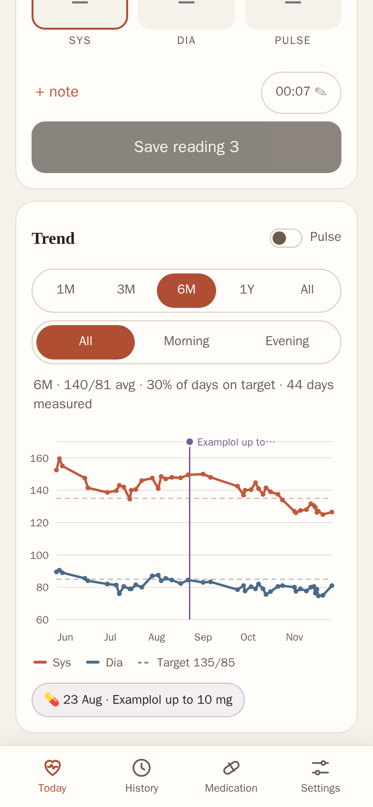
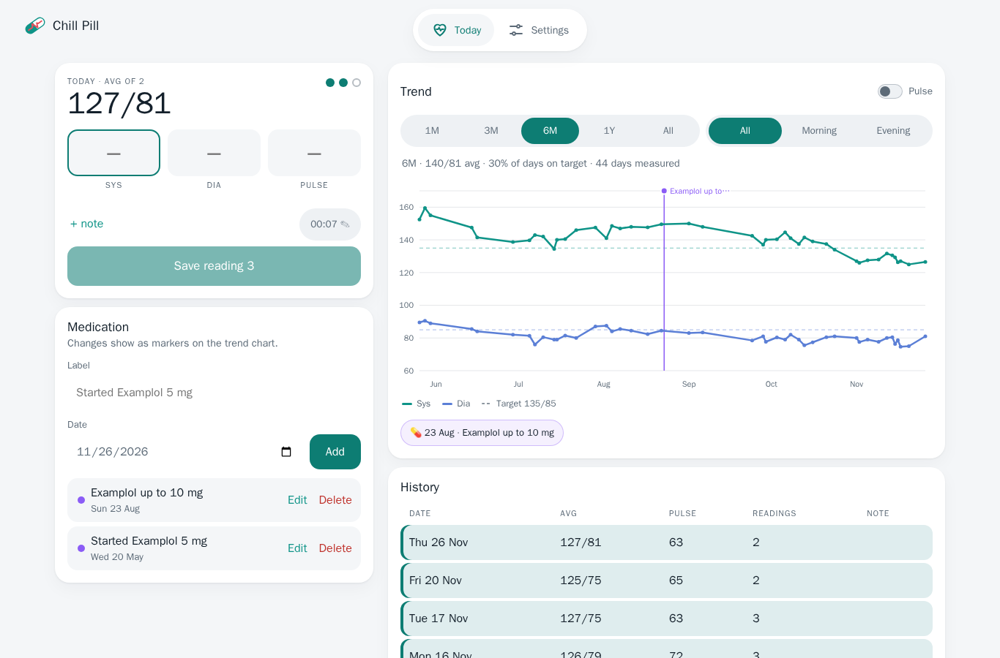

<h1 align="center">
  
</h1>

<p align="center">
  Log your blood pressure in seconds and see where it's heading.
</p>

<p align="center">
  <a href="https://github.com/ackervekenbm/chill-pill/actions/workflows/ci.yml"></a>
  <a href="https://github.com/ackervekenbm/chill-pill/actions/workflows/docker-build.yml"></a>
  <a href="LICENSE"></a>
  <a href="https://github.com/ackervekenbm/chill-pill/pkgs/container/chill-pill"></a>
</p>

You just took your blood pressure, the cuff is still on the table, and the
numbers are on the screen. Chill Pill is the app you open on your phone right
then: type three numbers, tap save, done. Over weeks and months it turns those
readings into daily averages and a clear trend, with your target and your
medication changes on the same chart, so you and your doctor can see what's
working.

It replaces the spreadsheet: no PC needed, no empty rows to fill in, and a
chart that actually follows the calendar. It runs in one small container on a
Raspberry Pi or any other box at home, and your readings never leave it.

*Every screenshot shows made-up demo readings.*

## Highlights

- ⚡ **Quick entry.** The number pad opens on systolic and jumps to the next field as soon as a value is complete. Time is filled in for you; change it to add a reading for an earlier day. Saved by mistake? Undo.
- 📅 **Daily averages.** Readings on the same day become one daily average, however many you take, and every day counts the same in the trend.
- 📈 **A trend that follows the calendar.** Ranges from one month to everything (1M, 3M, 6M, 1Y, All), morning or evening only, dashed target lines, and a summary of your average and the share of days on target.
- 💊 **Medication markers.** Note a medication change and it shows on the chart. Tap it to compare the month before with the month after.
- 🩺 **Doctor report.** A clean, printable page with the summary, chart, medication changes and every reading. Print it or save it as a PDF.
- 🎨 **Three themes:** Clinical calm, Dark dashboard and Warm editorial.
- 📱 **Installable on your iPhone.** Add it to your home screen and it opens full screen, like a native app.
- 📤 **CSV export.** All readings and medication changes in one file that opens in any spreadsheet.
- 🍓 **Runs on a Raspberry Pi.** One small container for `amd64` and `arm64`, nothing to configure.

<table>
  <tr>
    <td align="center"><br><sub>Clinical calm</sub></td>
    <td align="center"><br><sub>Dark dashboard</sub></td>
    <td align="center"><br><sub>Warm editorial</sub></td>
  </tr>
</table>

<p align="center">
  
</p>

## Quick start

You need **Docker**. Nothing else: no accounts, no keys.

```bash
curl -O https://raw.githubusercontent.com/ackervekenbm/chill-pill/main/docker-compose.yml
docker compose up -d
```

Open <http://localhost:8184> (or `http://<server-ip>:8184` from your phone)
and save your first reading. The image is public and built for `amd64` and
`arm64`, so any 64-bit OS works, a Raspberry Pi included. Updating is
`docker compose pull && docker compose up -d`; your readings stay in the
`chill-pill-data` volume. For OpenMediaVault and other setups, see
[Deployment](#deployment).

## Features in detail

<details>
<summary><strong>Logging a reading</strong></summary>

- The entry card opens on systolic with the number pad up, and jumps to diastolic and pulse as soon as a value is complete. Add a note if you like.
- Date and time are filled in for you. Change them to add a reading you took earlier.
- Saved by mistake? **Undo** takes it back.
- Readings before noon count as morning readings, from noon on as evening ones.

</details>

<details>
<summary><strong>History and the daily average</strong></summary>

- **History** lists your days, newest first, each with its daily average. However many readings you take in a day, they become one average, and every day counts the same in the trend.
- Open a day to see its readings. **Edit** changes the date, time, numbers or note; **Delete** removes a reading, with **Undo** for a few seconds.

</details>

<details>
<summary><strong>The trend and your target</strong></summary>

- The chart follows the calendar: 1M, 3M, 6M, 1Y or All, with every point at its date, so a week without readings still takes a week of room.
- Show all readings, mornings only or evenings only.
- Dashed lines show your target. A day counts as on target when its average is below both numbers; the summary shows your average and the share of days on target.

</details>

<details>
<summary><strong>Medication changes</strong></summary>

- Note a change with a date and a label ("Started Examplol 5 mg") and it shows as a marker on the chart.
- Tap a marker to compare the month before the change with the month after.

</details>

<details>
<summary><strong>Doctor report and CSV export</strong></summary>

- **Settings → Doctor report** opens a clean, printable page with the summary, the chart, your medication changes and every reading. Print it or save it as a PDF.
- **Settings → Export CSV** downloads every reading and medication change as one file that opens in any spreadsheet.

</details>

<details>
<summary><strong>Install on your iPhone</strong></summary>

1. Open Chill Pill in **Safari** on your iPhone (your phone has to be on the
   same network as the server).
2. Tap **Share**, then **Add to Home Screen**, then **Add**.

It now opens full screen from its own icon, straight into the entry card. The
same works on Android from the browser menu (**Add to Home screen** or
**Install app**).

</details>

<details>
<summary><strong>Import from a spreadsheet</strong></summary>

Already tracking in a spreadsheet? Bring it in once with the importer, run
from a copy of this repository on your computer (Node 22 or newer):

```bash
npm install
npm run import -- path/to/your.xlsx --to http://<server-ip>:8184 --dry-run   # check what it finds
npm run import -- path/to/your.xlsx --to http://<server-ip>:8184
```

It reads the `DATA` tab: a `Date` column and up to three groups of systolic,
diastolic and pulse per row. Empty rows are skipped and incomplete ones are
listed. Imported readings have no time, so they count as morning readings.
Running it twice adds nothing twice. Details:
[docs/deploy/operations.md](docs/deploy/operations.md#importing-a-spreadsheet-one-time).

</details>

<details>
<summary><strong>Settings and about</strong></summary>

**Settings** holds the theme (Clinical calm, Dark dashboard or Warm editorial),
your blood pressure target, and the links to the doctor report and the CSV
export. At the bottom, **About** says which build is running (the commit,
linked to GitHub, and when it was built; "development build" when you run it
yourself), with links to the source, the issue tracker, the author and the
license.

</details>

## Where your data lives

Everything is in one SQLite file on your server (`/app/data/chill-pill.db` in
the container): your readings and notes, medication changes and your settings,
theme included. The browser keeps nothing. Back up that folder, or use
**Settings → Export CSV** for a copy you can open anywhere. No accounts, no
tracking, no telemetry: the app doesn't call out to anything.

There is **no login**, so keep Chill Pill on your home network or tailnet, and
never forward a port to it from the internet.

Chill Pill shows your numbers against the target you choose. It doesn't
diagnose anything; talk to your doctor about what the numbers mean.

## Deployment

One small process serves the app and its API; there is nothing to configure.
Pick a route in [docs/deploy/](docs/deploy/README.md):

| Route | Guide |
|---|---|
| **Prebuilt image** with Docker Compose (start here) | [docker-image.md](docs/deploy/docker-image.md) |
| **OpenMediaVault** with its Compose plugin (the reference setup) | [openmediavault.md](docs/deploy/openmediavault.md) |
| **Docker**, built from a checkout | [from-source-docker.md](docs/deploy/from-source-docker.md) |
| **Bare Node** with systemd | [from-source-node.md](docs/deploy/from-source-node.md) |

Settings, updating, rollback and backups are in [operations.md](docs/deploy/operations.md); HTTPS behind a reverse proxy in [https.md](docs/deploy/https.md); fixes in [troubleshooting.md](docs/deploy/troubleshooting.md).

## Development

You need Node 22 or newer.

```bash
npm install
npm run dev                 # API on :3094, app on :5184 (open this one)
npm run seed -- --to http://localhost:3094   # made-up readings into an empty dev instance
```

```bash
npm run build               # type-check, lint, client build, server build
npm test                    # unit and component tests
npm run icons               # redraw the app icons from scripts/gen-icons.mjs
```

The README banner and screenshots come from `scripts/banner.mjs` and
`scripts/screenshots.mjs` (made-up demo data only; Playwright is installed for
the run, not as a dependency).

<details>
<summary><strong>Project structure</strong></summary>

```
src/
├── client/          React app: screens, components, data hook, themes
├── server/          Express API, SQLite store, CSV export, spreadsheet import
└── shared/          types, validation and statistics used by both
scripts/             demo seed, spreadsheet import, icons, README banner and screenshots
docs/                deployment guides, README banner and screenshots
```

Tech stack: React 19 · TypeScript · Vite · Recharts · Express 5 ·
better-sqlite3 · Vitest + Testing Library. Architecture and conventions are in
[AGENTS.md](AGENTS.md).

</details>

## Contributing

Issues and pull requests are welcome. Every change starts with an issue and
lands as one pull request with `Fixes #<n>`; `npm run build && npm test` must
pass, and the README and docs change in the same pull request when what they
describe changes. The details are in [AGENTS.md](AGENTS.md). Security problems:
see [SECURITY.md](SECURITY.md).

## License

Chill Pill is free software under the
[GNU Affero General Public License v3.0 or later](LICENSE).
